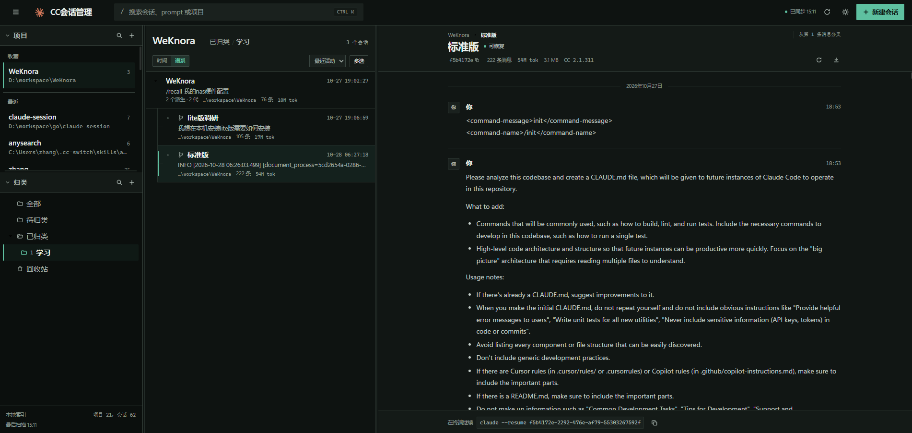
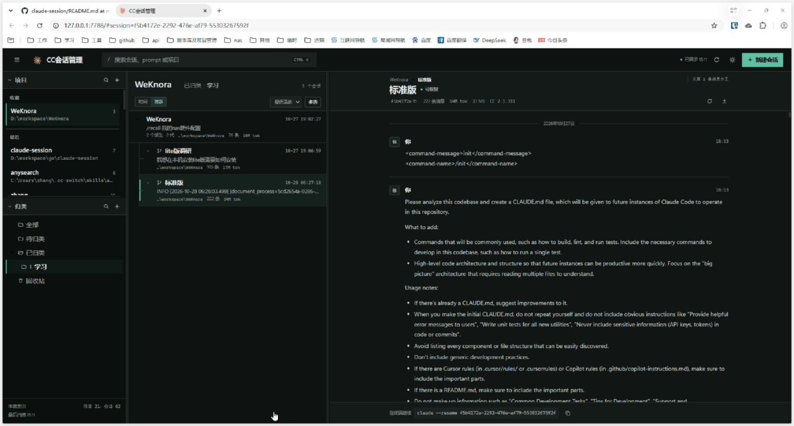

# Claude Session

English | [简体中文](README.md)


A local web UI for browsing, organizing, and resuming Claude Code sessions, grouped by project, with AI-generated summaries and grouping suggestions powered by your local Claude Code.

Built with Go, SQLite, and vanilla front-end code. Ships as a single process and a single binary, listening on `127.0.0.1` only.





> This is a practice project for learning Go — feel free to learn from it.

## Features

- **Grouped by project**: scans `~/.claude/projects` and groups sessions by the `cwd` in each jsonl; the list shows title, last prompt, timestamp, message count, token usage, and git branch. On Windows, paths that differ only in casing are resolved to the real on-disk casing and merged into one project
- **Full-text search**: FTS5 trigram (Chinese substring matching), plus title / prompt / session ID search, with `Ctrl+K` to focus
- **Logical groups**: nested folders, move, and rename, stored in SQLite only — the directory layout under `~/.claude/projects` is never touched. Switching projects defaults to "Categorized" and remembers each project's last selected group view
- **Lineage view**: parses `forkedFrom` and shows fork relationships, a family tree, fork points, and the full ancestry chain
- **Session actions**: resume, rename, compact, branch, fork, bulk delete, and trash restore
- **AI summaries**: generated with your local Claude Code, shown in the list and on the detail page, including suggested titles
- **AI tidy-up**: suggests project-level groups for review and apply; sessions grouped by hand are never touched. A fork/branch lineage (including multi-level descendants) always lands in one group, and child sessions follow an already-grouped parent
- **Live refresh**: Claude Code hooks trigger incremental scans, SSE pushes updates, and a 30-second scan acts as a fallback
- **Local first**: jsonl is the source of truth, deleting the database does not affect Claude Code; listens on localhost only and validates the Origin header

## Requirements

- Windows (the terminal integration targets Windows Terminal and PowerShell)
- Go 1.27+ to build from source
- Claude Code installed and signed in, with sessions under `~/.claude/projects`

## Quick start

### Prebuilt release

- Double-click `session-deck.exe` or `start.bat`. The app runs in the background and opens <http://127.0.0.1:7788> automatically
- Logs are written to `data/session-deck.log`
- To stop, double-click `stop.bat` or end `session-deck.exe` in Task Manager

### Run from source

```bash
go run ./cmd/server
```

### Build

```bash
# Release build: GUI subsystem, no console window
go build -trimpath -ldflags "-H windowsgui -s -w" -o bin/session-deck.exe ./cmd/server

# Debug build: keeps console output
go build -o bin/session-deck-debug.exe ./cmd/server
```

## Configuration

| Flag | Default | Description |
|---|---|---|
| `-addr` | `127.0.0.1:7788` | Listen address |
| `-db` | `data/sessions.db` | SQLite database path |
| `-projects` | `~/.claude/projects` | Claude Code session directory |

## Usage

### Shortcuts

| Shortcut | Action |
|---|---|
| `Ctrl+K` | Focus search |
| `Ctrl+P` | Search projects |

### AI summaries and tidy-up

- **Summary**: the detail page shows goals, key actions, conclusions, and topic tags with empty / loading / error / success states; retry or regenerate at any time. The list shows the AI summary first, with highlighted search hits
- **Suggested title**: shown when a session has no custom title and adoptable from either the detail page or the list
- **AI tidy-up**: fills in missing summaries, generates grouping suggestions, then opens a preview. Groups can be new nested groups or existing ones; sessions with confidence below 0.6 are unchecked by default, and the run can be discarded. Summaries run 4-way parallel and grouping 3-way parallel, the button shows `summary / grouping x/y` progress, and a manual run handles up to 200 pending sessions
- **Forked sessions**: a fork with fewer than 3 new messages inherits its parent's summary; otherwise only content after the fork point is sampled
- **Sampling and privacy**: the first 8 and last 4 meaningful prompts plus the conclusion tail, with a 1,500-character budget. Low-information replies are skipped and secrets (`sk-`, `ghp_`, `AKIA`, `Bearer`, `password`, etc.) are redacted
- **Invocation and cost**: `claude -p --output-format json --no-session-persistence --tools ""` with JSON Schema constrained output and automatic `bare` / `lean` / `plain` probing. 15 sessions per batch by default, failed batches retried one by one; the settings panel shows usage and cumulative cost
- **Settings**: enablement, model, capability probing, minimum messages, character budget, enqueue limit, batch size, conclusion tail, and excluded projects

### Opening a terminal

`POST /api/sessions/{id}/open` reuses the most recent Windows Terminal window:

```
wt.exe -w 0 nt -d <project path> pwsh.exe -NoExit -EncodedCommand <PowerShell Base64>
```

Fallback order: `pwsh` + Terminal → `powershell` + Terminal → `cmd /c start` in a new window → return an error and keep the resume command available for copying.

Security constraints: session IDs must be UUIDs; project paths must belong to an indexed project and contain no quotes, newlines, or NUL; commands are passed as argument arrays, never concatenated into a shell string.

## API

```
GET    /api/health
GET    /api/projects
POST   /api/projects                    { path }
PATCH  /api/projects/{id}               { pinned?, alias? }
POST   /api/projects/{id}/move          { direction: up|down }
POST   /api/projects/{id}/touch
DELETE /api/projects/{id}
GET    /api/projects/{id}/folders
POST   /api/projects/{id}/folders      { name, parent_id? }
PATCH  /api/projects/{id}/folders/{folder}   { name }
POST   /api/projects/{id}/folders/{folder}/move  { direction: up|down }
DELETE /api/projects/{id}/folders/{folder}
GET    /api/sessions?project_id=&folder_id=&q=&deleted=&limit=
POST   /api/sessions                   { project_id, folder_id, title, first_message, mode }
POST   /api/sessions/batch-delete      { ids, permanent }
GET    /api/sessions/{id}
GET    /api/sessions/{id}/ancestors
GET    /api/sessions/{id}/export       ?format=json|md
PATCH  /api/sessions/{id}              { folder_id?, title? }
DELETE /api/sessions/{id}              ?permanent=1
POST   /api/sessions/{id}/open
POST   /api/sessions/{id}/branch
POST   /api/sessions/{id}/fork
POST   /api/sessions/{id}/compact
POST   /api/projects/{id}/trash/purge
POST   /api/sessions/{id}/restore
POST   /api/ai/summarize               { project_id?, ids?, force? }
GET    /api/ai/status                  ?project_id=
POST   /api/ai/probe
GET    /api/ai/settings
PATCH  /api/ai/settings                { enabled?, model?, min_messages?, max_chars?, … }
GET    /api/ai/jobs/{id}
POST   /api/ai/categorize              { project_id?, reevaluate? }
GET    /api/ai/suggestions             ?job_id=
POST   /api/ai/suggestions/apply       { job_id, folder_ids?, session_ids? }
POST   /api/ai/suggestions/discard     { job_id }
GET    /api/fs/dirs?path=
POST   /api/sync
POST   /api/hooks/refresh
GET    /api/hooks/config
GET    /api/events                     SSE
```

- `mode` is `cli` (runs `claude --session-id`) or `draft` (writes the jsonl only)
- `deleted=1` queries the trash; `folder_id=unfiled` selects sessions not yet grouped
- AI endpoints: `summarize` without `project_id` uses the project opened in the last 10 minutes, `force=1` regenerates; `categorize` with `reevaluate=true` reassesses AI-created groups; `apply` without IDs applies every suggestion

## Design principles

- **jsonl is the source of truth**: SQLite holds only indexes, groups, AI summaries, and other local metadata; deleting the database does not affect Claude Code
- **Groups are logical**: folders exist only in SQLite and never change the layout under `~/.claude/projects`
- **Lineage is read-only**: `parent_id` / `fork_point_uuid` are parsed from `forkedFrom` in the first jsonl line; session files are never modified. Relationships survive parent deletion and are shown as missing
- **AI data stays local**: summaries, jobs, and suggestions live in `session_ai` / `ai_jobs` / `ai_suggestions` / `ai_folder_suggestions` and never modify jsonl; summary text is backfilled into the full-text index after scans
- **Write protection**: `~/.claude/sessions/*.json` is checked before rename and delete; a running session returns 409. Deletions move to `~/.claude-session/trash/<session-id>/` and can be restored
- **30-day cleanup**: after Claude Code removes expired transcripts, sessions whose files disappear are marked `missing` while local grouping records are kept

## Project structure

```
cmd/server/          entry point
internal/api/        HTTP routes, SSE, hooks
internal/ai/         AI summaries, grouping suggestions, CLI invocation, job queue
internal/creator/    create sessions via CLI or draft
internal/scanner/    jsonl scanning, metadata parsing, summary sampling, title writes
internal/store/      SQLite index, groups, full-text search, AI summaries
internal/trash/      trash file moves and restore
internal/opener/     terminal and PowerShell launch
internal/model/      data models
web/                 front end (embedded into the binary)
data/                SQLite database (created at runtime)
```

## Live refresh

The server exposes `POST /api/hooks/refresh`; fetch a ready-to-paste snippet from `GET /api/hooks/config`:

```json
{
  "hooks": {
    "Stop": [
      { "hooks": [ { "type": "command", "command": "curl -s -X POST http://127.0.0.1:7788/api/hooks/refresh >/dev/null" } ] }
    ],
    "SessionStart": [
      { "hooks": [ { "type": "command", "command": "curl -s -X POST http://127.0.0.1:7788/api/hooks/refresh >/dev/null" } ] }
    ],
    "SessionEnd": [
      { "hooks": [ { "type": "command", "command": "curl -s -X POST http://127.0.0.1:7788/api/hooks/refresh >/dev/null" } ] }
    ]
  }
}
```

Merge these events into `~/.claude/settings.json`. Each completed reply, session start, or session end then triggers an incremental scan, and the page refreshes over SSE. Without hooks, the 30-second scan still runs as a fallback.

## Roadmap

- Editing session content
- Tags and bulk operations
- Multi-instance / remote access

## License

[Apache-2.0](LICENSE)