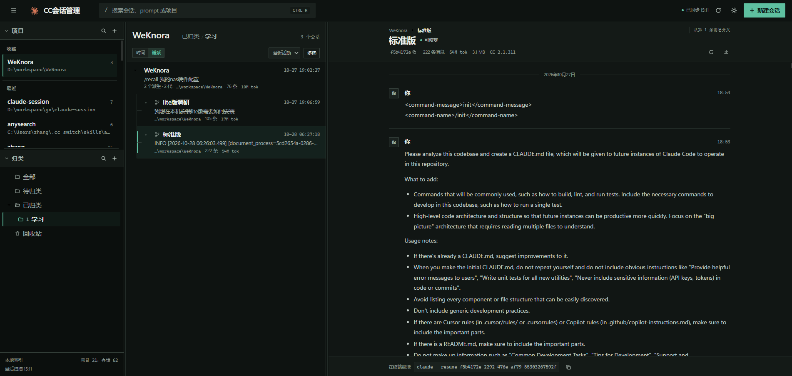
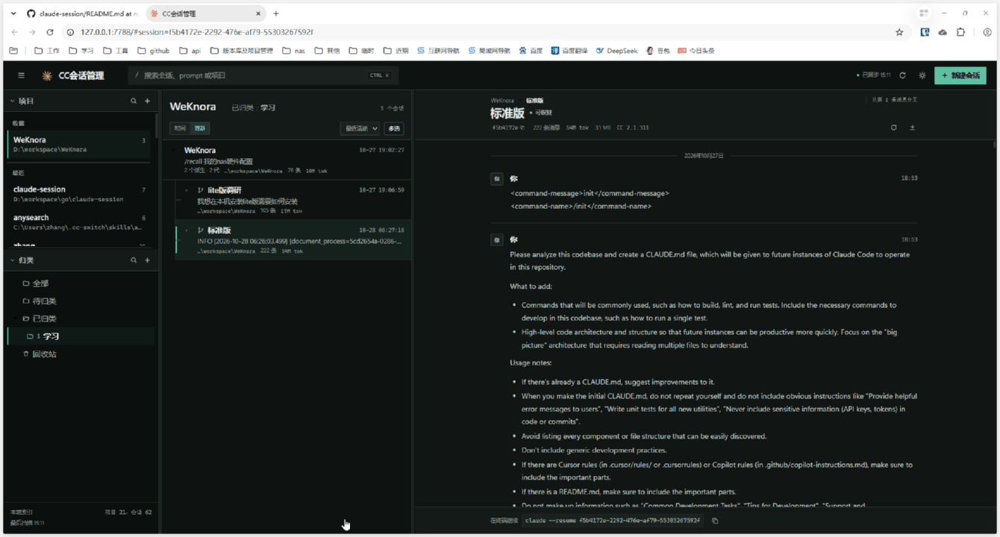

# Claude Code 会话管理

[English](README.en.md) | 简体中文

> **说明**：本项目是为了学习 Go 开发而做的练习项目，欢迎大家给予指正并一起学习。

以项目为单位浏览、归类和恢复本机 Claude Code 会话的本地 Web 工具。

Go + SQLite + 原生前端，单进程、单二进制，只监听 `127.0.0.1`。

## 界面





## 解决什么问题

Claude Code 把每段对话以 jsonl 文件存在 `~/.claude/projects` 下，文件名是 UUID，恢复只能靠 `claude --resume <id>`。会话一多，就变成了"知道聊过，但找不到、记不住、管不动"。

| 痛点 | 本项目的做法 |
|---|---|
| 会话散落在按路径转换命名的目录里，不知道哪段对话属于哪个项目 | 扫描并索引全部会话，按 jsonl 中的 `cwd` 归并成项目，列表直接给出标题、最后一条 prompt、时间、消息数、token 用量、git 分支 |
| 找回旧会话只能翻终端历史，或凭记忆猜 UUID | 全文搜索会话内容（FTS5 trigram，支持中文子串）、按标题 / 最后 prompt / 会话 ID 搜索、`Ctrl+K` 唤起搜索框 |
| Claude Code 没有文件夹概念，会话无法组织 | 逻辑归类：多层嵌套分组、移动会话、重命名归类；只写 SQLite，不改动 `~/.claude/projects` 的目录结构 |
| 用 branch / fork 分出去的会话和原会话在列表里毫无关联，看不出谁从谁分出来 | 解析 jsonl 首行的 `forkedFrom`，列表显示「派生自『父标题』」与派生计数；谱系视图按家族成树；详情页给出完整血缘链和分叉点 |
| 长会话上下文越滚越长，token 成本持续升高 | 一键调用 `claude --resume <id> -p /compact`，走 Claude Code 官方的压缩流程 |
| 想从某个历史节点分出一条新思路，又不想破坏原会话 | `branch` 复制历史并切换到新会话，`fork` 复制为独立副本，新会话写入 `forkedFrom`，原会话不受影响 |
| 多项目来回切换，常用项目难找 | 项目收藏置顶、项目别名、最近访问分组、`Ctrl+P` 项目搜索 |
| 误删会话无法挽回 | 删除进回收站（jsonl 与同名附件目录一起移动），支持预览、还原、彻底删除 |
| Claude Code 30 天清理会删掉旧 transcript，索引变成死链 | 检测不到文件时把会话标记为 `missing`，但保留本地的归类、归属记录 |
| 会话正在运行时改名或删除，会导致状态冲突 | 写入前检查 `~/.claude/sessions/*.json`，会话运行中返回 409 |
| 页面里的数据总得手动刷新 | Claude Code hooks 触发增量扫描，SSE 推送实时刷新，30 秒定时扫描兜底 |

## 功能

### 会话浏览与搜索

- 扫描 `~/.claude/projects`，读取 jsonl 元数据，按 `cwd` 归并项目
- 会话列表：标题、最后 prompt、时间、项目路径、消息数、token 用量、git 分支
- 会话详情：消息时间线、工具调用折叠、截断提示；一键复制完整会话 ID；归类以面包屑标签展示；支持导出原始 JSON（.jsonl）或 Markdown（.md）
- 详情页血缘：标题上方显示「根 › 父 › 当前」链路，可逐级跳转；派生会话标注「从第 N 条消息分叉」
- 全局搜索（标题 / 最后 prompt / 会话 ID）
- FTS5 全文搜索（trigram tokenizer，支持中文子串）
- 快捷键：`⌘K` / `Ctrl+K` 聚焦搜索，`⌘P` / `Ctrl+P` 搜索项目
- 派生关系：列表在 meta 行显示「派生自『父标题』」标签与「N 个派生」计数；父会话在回收站或已被清理时标注状态，点击标签跳到父会话
- 谱系视图：列表头「时间 / 谱系」切换。谱系视图里父会话在上、派生会话缩进在下，可折叠；家族之间按当前排序规则排列，族内始终按派生先后排列，避免树结构随排序跳变
- 排序规则：最近活动按日期分组；消息数 / 标题排序输出单一列表，不再显示日期分组

### 会话管理与续写

- 会话列表操作：悬停会话显示恢复、重命名、压缩、分支、副本、归属项目、加入归类、删除图标；多选后可在批量栏统一加入归类
- 会话列表多选删除，支持批量移入回收站或彻底删除
- 重命名：同时追加 `custom-title` 行，Claude Code 可按新标题恢复
- 新建会话：CLI 创建（调用 Claude Code）或仅写草稿文件
- 删除到回收站、还原、彻底删除（回收站中的会话仍可预览）
- 回收站清空：可一键清空当前项目回收站；回收站为空时显示空状态
- 上下文压缩：调用 `claude --resume <id> -p /compact` 执行 Claude Code 的压缩流程
- 会话分支：`branch` 复制历史并切换到新会话，`fork` 复制为独立副本且保持当前会话，均生成新 session ID 并写入 `forkedFrom`；点击后输入名称，新标题为 `原标题-branch-名称` / `原标题-fork-名称`（留空则按 `001`、`002`… 自动编号，如 `原标题-branch-001`），弹窗内可勾选「创建后在终端打开会话」（默认选中）
- 在 Windows Terminal + PowerShell 中恢复会话

### 项目与归类

- 添加项目：登记一个尚未产生会话的工作目录；支持手动输入或浏览本机磁盘选择
- 项目收藏：星标项目后置顶显示，状态保存在 SQLite
- 项目别名：可为项目设置别名（星标旁的铅笔按钮），设置后项目列表、会话归属下拉、新建会话等位置统一显示别名；留空恢复原名
- 项目搜索：项目栏内过滤名称/路径，支持 `Ctrl+P` 聚焦
- 最近访问：最近打开的 5 个项目显示在「最近」分组
- 删除项目：移除项目及其下会话索引，会话文件移到本机回收站；磁盘上的项目目录不会被修改
- 逻辑归类：「已归类」分组、多层嵌套（支持五层以上）、展开/收起、新建/重命名/删除归类、移动会话；只写 SQLite，不移动会话文件

### 界面与交互

- 主题切换：顶栏太阳/月亮图标一键切换深色、浅色主题，选择保存在 localStorage，默认使用浅色
- 侧栏折叠：项目栏和归类栏可分别折叠/展开；顶栏 ☰ 可将整个侧栏沿左右方向收起/展开，状态保存在 localStorage
- 布局可拖拽：三栏宽度、项目区高度均可拖动调整，保存到 localStorage

### 数据刷新与安全

- Claude Code hooks 触发异步扫描，SSE 推送到页面实时刷新
- 每 30 秒自动扫描，支持手动重新扫描
- 只监听 `127.0.0.1`，校验 Origin；会话 ID 必须是 UUID，项目路径必须来自已索引项目

## 运行

发布包：

- 双击 `session-deck.exe` 或 `start.bat`，程序在后台运行，不显示命令行窗口
- 自动打开 http://127.0.0.1:7788
- 日志写入 `data/session-deck.log`
- 停止：双击 `stop.bat`，或在任务管理器结束 `session-deck.exe`

开发调试（带控制台）：

```bash
go run ./cmd/server
```

参数：

| 参数 | 默认值 | 说明 |
|---|---|---|
| `-addr` | `127.0.0.1:7788` | 监听地址 |
| `-db` | `data/sessions.db` | SQLite 路径 |
| `-projects` | `~/.claude/projects` | Claude Code 会话目录 |

构建：

```bash
# 发布版：GUI 子系统，无控制台窗口
go build -trimpath -ldflags "-H windowsgui -s -w" -o bin/session-deck.exe ./cmd/server

# 调试版：保留控制台输出
go build -o bin/session-deck-debug.exe ./cmd/server
```

> `-H windowsgui` 让程序以 GUI 子系统运行，双击不弹出命令行窗口；日志统一写入 `data/session-deck.log`。

## 数据原则

- **jsonl 是唯一真值**：SQLite 只保存索引、归类、标签等本地元数据，删除数据库不会影响 Claude Code。
- **归类是逻辑的**：文件夹只存在 SQLite 中，不改变 `~/.claude/projects` 的目录结构。
- **派生关系只读**：`parent_id` / `fork_point_uuid` 从 jsonl 首行 `forkedFrom` 解析，不修改会话文件；父会话被删除后关系保留，界面显示为缺失。
- **30 天清理**：Claude Code 默认清理过期 transcript，本系统会把找不到文件的会话标记为 `missing`，但不会自动删除本地归类记录。
- **写入保护**：重命名、删除前检查 `~/.claude/sessions/*.json`，会话正在运行时返回 409。
- **回收站**：删除时把 jsonl 与同名附件目录移动到 `~/.claude-session/trash/<session-id>/`，可还原，也可彻底删除。
- **全文索引**：`sessions_fts` 是 SQLite FTS5 虚拟表，正文最多索引每个会话的前 200KB 文本；短于 3 个字的查询自动退回 LIKE。

## 打开终端

`POST /api/sessions/{id}/open` 会执行：

```
wt.exe -w 0 nt -d <项目路径> pwsh.exe -NoExit -EncodedCommand <PowerShell Base64>
```

`-w 0`（`last`）表示复用最近使用的 Windows Terminal 窗口：在其中新建标签页并把窗口召唤到前台；当前没有 Terminal 窗口时由 `wt` 自动新建窗口。

降级顺序：

1. `pwsh.exe` + Windows Terminal
2. `powershell.exe` + Windows Terminal
3. `cmd /c start` 新开窗口
4. 返回错误，前端保留复制恢复命令

安全约束：

- 会话 ID 必须是 UUID
- 项目路径必须来自已索引项目，且拒绝引号、换行、NUL
- 命令使用参数数组传递，不拼接 shell 字符串
- 只监听本机，并校验 Origin

## API

```
GET    /api/health
GET    /api/projects
POST   /api/projects                    { path }
PATCH  /api/projects/{id}               { pinned?, alias? }
POST   /api/projects/{id}/move          { direction: up|down }  调整收藏项目顺序
POST   /api/projects/{id}/touch
DELETE /api/projects/{id}
GET    /api/projects/{id}/folders
POST   /api/projects/{id}/folders      { name, parent_id? }
PATCH  /api/projects/{id}/folders/{folder}   { name }
POST   /api/projects/{id}/folders/{folder}/move  { direction: up|down }  调整归类顺序
DELETE /api/projects/{id}/folders/{folder}
GET    /api/sessions?project_id=&folder_id=&q=&deleted=&limit=
POST   /api/sessions                   { project_id, folder_id, title, first_message, mode }
POST   /api/sessions/batch-delete      { ids, permanent }
GET    /api/sessions/{id}
GET    /api/sessions/{id}/ancestors    从根到父会话的血缘链
GET    /api/sessions/{id}/export       ?format=json|md
PATCH  /api/sessions/{id}              { folder_id?, title? }
DELETE /api/sessions/{id}              ?permanent=1 彻底删除
POST   /api/sessions/{id}/open
POST   /api/sessions/{id}/branch
POST   /api/sessions/{id}/fork
POST   /api/sessions/{id}/compact
POST   /api/projects/{id}/trash/purge
POST   /api/sessions/{id}/restore
GET    /api/fs/dirs?path=
POST   /api/sync
POST   /api/hooks/refresh
GET    /api/hooks/config
GET    /api/events                     SSE
```

`mode` 取 `cli`（调用 `claude --session-id`）或 `draft`（只写 jsonl）。`deleted=1` 查询回收站。

`folder_id` 取 `unfiled` 表示待归类，取数字表示具体归类。

## 目录结构

```
cmd/server/          启动入口
internal/api/        HTTP 路由、SSE、hooks
internal/creator/    CLI / 草稿方式创建会话
internal/scanner/    jsonl 扫描、元数据解析、消息读取、标题写入
internal/store/      SQLite 索引、归类、全文检索
internal/trash/      回收站文件移动与还原
internal/opener/     终端与 PowerShell 启动
internal/model/      数据模型
web/                 前端（embed 进二进制）
data/                SQLite 数据库（运行时生成）
```

## Claude Code 实时刷新

服务提供 `POST /api/hooks/refresh`。配置片段可通过 `GET /api/hooks/config` 获取，示例：

```json
{
  "hooks": {
    "Stop": [
      { "hooks": [ { "type": "command", "command": "curl -s -X POST http://127.0.0.1:7788/api/hooks/refresh >/dev/null" } ] }
    ],
    "SessionStart": [
      { "hooks": [ { "type": "command", "command": "curl -s -X POST http://127.0.0.1:7788/api/hooks/refresh >/dev/null" } ] }
    ],
    "SessionEnd": [
      { "hooks": [ { "type": "command", "command": "curl -s -X POST http://127.0.0.1:7788/api/hooks/refresh >/dev/null" } ] }
    ]
  }
}
```

把对应事件合并进 `~/.claude/settings.json` 后，每次回复结束、会话开始或结束都会触发一次增量扫描，页面通过 SSE 自动刷新。未配置 hooks 时仍有 30 秒定时扫描兜底。

## 尚未实现

- 会话内容编辑
- 标签与批量操作
- 多实例/远程访问
